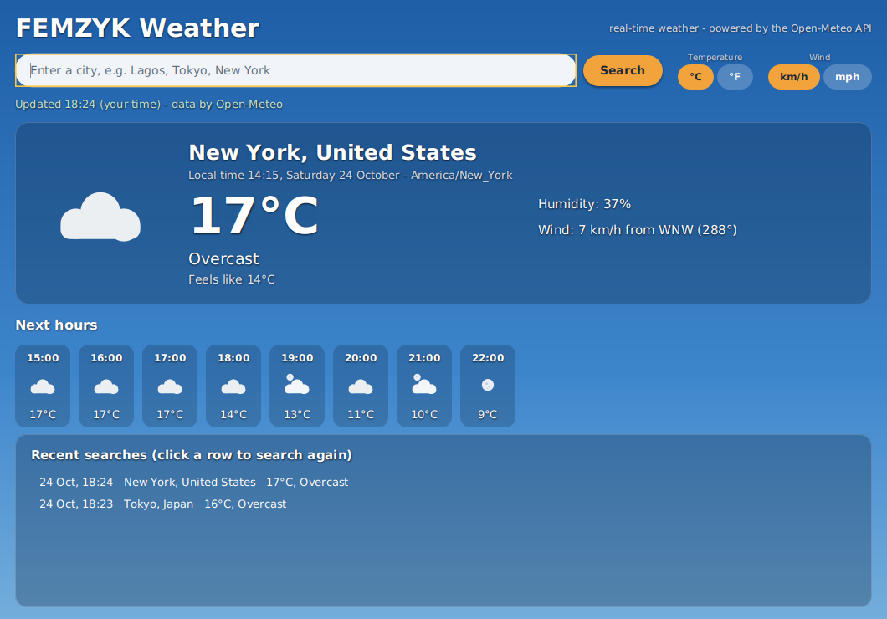
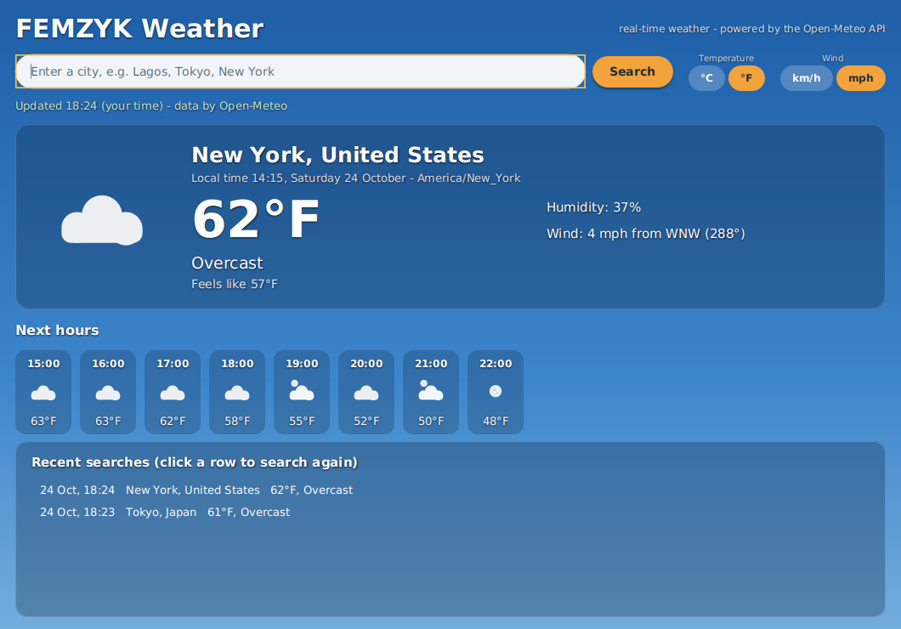
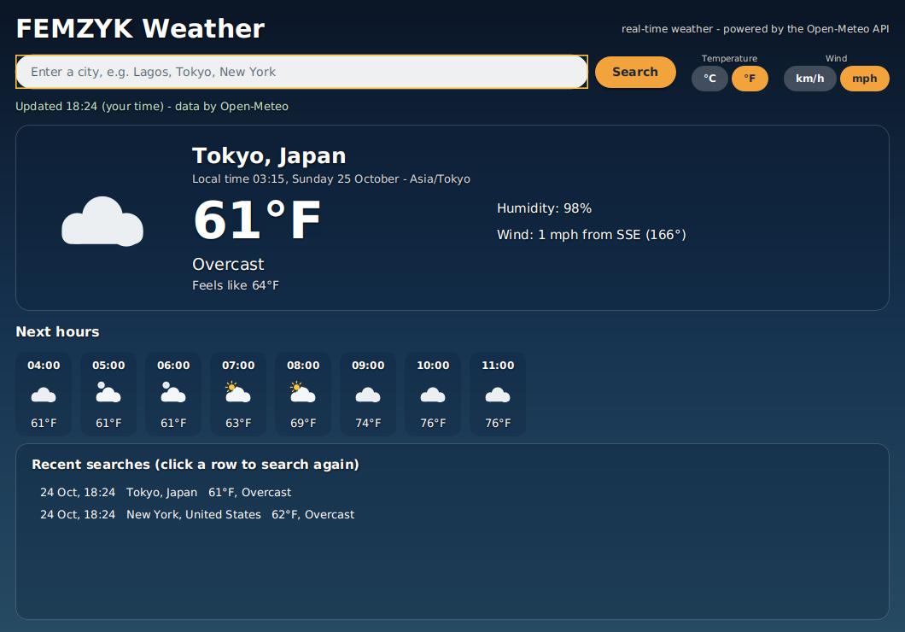

# FEMZYK Weather

A **real-time Weather Information App** built for *CS 1103-01 – Programming Assignment
Unit 8*: JavaFX graphical interface, live Open-Meteo API integration, weather icons,
an 8-hour forecast strip, Celsius/Fahrenheit + km/h/mph unit switching, persistent
search history with timestamps, styled error handling, and dynamic backgrounds that
follow the searched city's real time of day.

🔗 **Repository:** https://github.com/FEMZYKENTLTD/FEMZYK-WeatherApp



## ✨ Features (mapped to the assignment requirements)

| Requirement | Where it lives |
|---|---|
| **API integration** | `core/WeatherApiClient.java` - two-step REST conversation with the free, no-key [Open-Meteo](https://open-meteo.com/) APIs: geocoding (city → coordinates) then forecast (current + hourly). Built on `java.net.http.HttpClient` with timeouts, HTTP-status checks, and typed errors. |
| **GUI design** | `gui/WeatherApp.java` - styled JavaFX: sky-gradient stage, glass cards, rounded search field, orange Search button, unit toggle groups, hover-highlighted history list (`resources/css/styles.css`). |
| **Weather display** | Temperature, humidity, wind speed + compass direction, "feels like", conditions description, and the city's real local time & timezone. |
| **Icon representation** | `gui/WeatherIconCanvas.java` - sun, moon, sun/moon-behind-cloud, cloud, rain, snow, lightning bolt, and fog icons drawn as **vector graphics on Canvas** (no image files, no emoji fonts, crisp at any size). |
| **Forecast display** | The next 8 hours after the current observation, as mini cards (time, icon, temperature). |
| **Unit conversion** | °C ⇄ °F and km/h ⇄ mph toggles; the core always stores SI units, switching never re-contacts the API (`core/UnitConverter.java`, 11 unit tests). |
| **Error handling** | `core/WeatherApiException` + a red status banner: unknown city, blank input, network failure, HTTP errors, malformed responses - the app never crashes, previous data stays on screen. |
| **History tracking** | `core/SearchHistory.java` - newest-first, de-duplicated, capped at 8, persisted to `~/.femzyk-weather/history.json`; click a row to search again. |
| **Dynamic backgrounds** | The searched city's `is_day` flag + local hour pick one of four sky palettes: dawn, day, sunset, night (see the Tokyo night screenshot below). |

## 🧭 Architecture

```
FEMZYK-WeatherApp/
├── pom.xml                                  Maven build (JavaFX 26.0.2, Gson, JUnit 5)
├── docs/                                    Screenshots used by this README
└── src
    ├── main/java/com/femzyk/weather
    │   ├── core/                            Pure Java, no UI - fully unit-tested
    │   │   ├── WeatherApiClient.java        Open-Meteo geocoding + forecast, JSON parsing
    │   │   ├── WeatherApiException.java     User-readable typed errors
    │   │   ├── GeocodingResult.java         record: matched location
    │   │   ├── CurrentWeather.java          record: conditions now
    │   │   ├── ForecastHour.java            record: one forecast hour
    │   │   ├── WeatherReport.java           record: full search result
    │   │   ├── WmoWeather.java              enum: WMO code -> description + icon key
    │   │   ├── UnitConverter.java           C/F, km/h/mph, compass formatting
    │   │   ├── HistoryEntry.java            record: one history row
    │   │   └── SearchHistory.java           JSON-persisted, de-duplicated history
    │   └── gui/
    │       ├── WeatherApp.java              JavaFX stage, layout, theming, threading
    │       └── WeatherIconCanvas.java       Vector weather icons on Canvas
    ├── main/resources/css/styles.css        Control styling
    └── test/java                            28 JUnit tests (no network needed)
```

**Threading:** the API call runs on a background thread (`CompletableFuture`, 30 s
timeout) and only the finished result touches the UI through `Platform.runLater` -
the window never freezes while the network is busy.

## ✅ Requirements

- **JDK 17 or newer** (built and tested on JDK 25 with a clean `BUILD SUCCESS`,
  zero warnings, 28/28 tests passing)
- **Maven 3.8+** and internet access (the app fetches live data)
- VS Code users: the **Extension Pack for Java**

## 🚀 Run it

```bash
# easiest way - Maven handles the JavaFX modules for you
mvn clean package
mvn javafx:run
```

Manual equivalent (any JavaFX 26 SDK):

```bash
java --module-path "$PATH_TO_JAVAFX_LIB" --add-modules javafx.controls,javafx.swing \
     --add-opens javafx.graphics/com.sun.glass.ui=ALL-UNNAMED \
     -cp target/classes:$(mvn -q dependency:build-classpath -Dmdep.outputFile=/dev/stdout) \
     com.femzyk.weather.gui.WeatherApp
```

In VS Code: open the folder, wait for the Java extension to import the project, then
press **Run** above `main` in `WeatherApp.java` (or F5).

Then: type a city (e.g. `Lagos`, `Tokyo`, `New York`) → **Search** → toggle °F/mph →
click a history row to re-search. History persists in `~/.femzyk-weather/history.json`.

## 🖼 More screenshots

**Unit switching** (°F + mph, re-renders instantly - no new API call):



**Dynamic background** - Tokyo searched at the same moment: local 03:15, so the app
switches to the night palette, draws a moon icon, and shows sunrise hours at 07:00:



**Error handling** - an unknown city shows a styled red banner and keeps the
previous data on screen:


## 🧪 Testing

28 JUnit 5 tests cover the core layer without touching the network:

- `UnitConverterTest` (11): C/F and km/h/mph conversions, formatting, 16-point compass
- `WmoWeatherTest` (7): code mapping (0, 2, 3, 61, 95, 99) + safe fallback
- `WeatherApiClientTest` (5): parsing of real trimmed API samples, forecast slicing, blank-input rejection
- `SearchHistoryTest` (5): JSON round trip, newest-first, de-duplication, cap, corrupted-file safety

## 📚 Reading

- Eck, D. J. (2022). *Introduction to programming using Java, Version 9, JavaFX edition* - Ch. 6 (GUI basics) and Ch. 13 (properties/bindings, MVC, finishing touches): https://math.hws.edu/javanotes/
- Morelli, R. & Walde, R. - *Java, Java, Java*, Ch. 13 (GUI design principles): https://eng.libretexts.org/Bookshelves/Computer_Science/Programming_Languages/Java_Java_Java_-_Object-Oriented_Programming_(Morelli_and_Walde)
- Open-Meteo documentation (forecast + geocoding APIs, free for non-commercial use): https://open-meteo.com/en/docs

## Academic context

Course project for **CS 1103-01 – AY2027-T1, Programming Assignment Unit 8**
(University of the People). Weather data by [Open-Meteo](https://open-meteo.com/)
(CC BY 4.0, no API key required).
